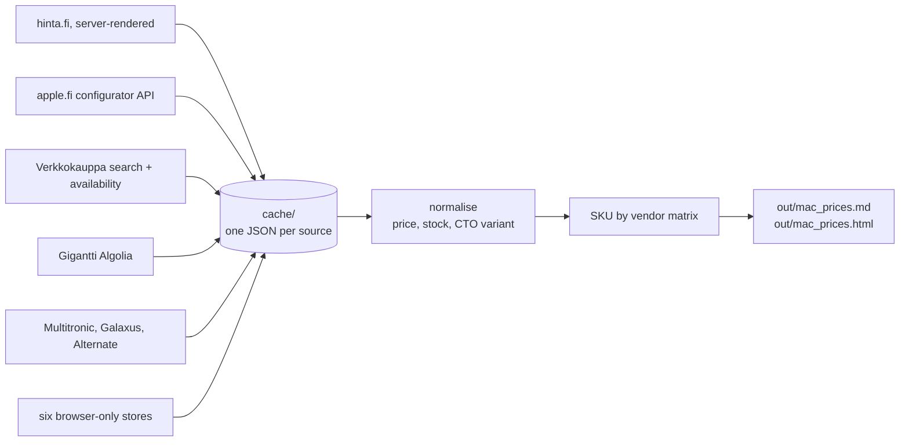

# mac-sku-prices — Mac mini & Mac Studio SKU × vendor price table (Finland)

Interactive browser tool: every SKU and common CTO variant of **Mac mini (M4 / M4 Pro, 2024)**
and **Mac Studio (M3 Ultra / M4 Max, 2025)** (+ bonus M2 family), with per-vendor price +
availability for ~25 Finnish-selling channels. Open `out/mac_prices.html` in a browser.

Frontend features (Tabulator grid, vendored locally in assets/ so it works offline):
- Global search (model, chip, RAM, SSD, vendor) · filters by Type / Chip / RAM / SSD
- "in stock only" toggle · vendor column visibility (All / None / Domestic presets)
- Sortable columns (click headers; price columns sort numerically) · Cheapest column
  recomputes live from the vendors you keep visible
- Availability dots: green=in stock, yellow=limited, red=out/made-to-order
- Export CSV · Reset; data embedded as JSON at build time (no server needed)

Note: filtering uses Array.filter + setData, NOT Tabulator's setFilter — setFilter(function)
causes "too much recursion" in Firefox with this table (frozen column + formatters).

> Note: there is no M3 Mac mini — Apple jumped M2 → M4 on the mini. "M3" only exists on the
> Mac Studio (M3 Ultra, 2025), which is included.

## Output
- `out/mac_prices.html` — interactive grid (search / sort / filter / vendor toggles) — open this
- `out/mac_prices.md` — plain markdown tables (same data)

Rows = SKU/config (RAM/SSD, CTO variants included, e.g. M4 32GB, M4 Pro 64GB, M3 Ultra 256GB).
Columns = vendors. Cell = price + availability tag. Last column = cheapest vendor for that SKU.

## Vendors covered (21 columns)
Domestic: Apple (apple.fi, RRP from the FI configurator API) · Verkkokauppa.com (live stock API) ·
Gigantti (Algolia, incl. stock) · Power · Telia · Elisa · Veikon Kone · Euronics · Multitronic ·
Datatronic · Jimm's PC-store · Tietokonekauppa · Data-Systems · Scandinavian Photo · CS Megastore
Foreign/shipping to FI: Proshop (DK) · NetOnNet (SE storefront, SEK→EUR approx /11) · Webhallen
(SE, SEK→EUR approx /11) · Amazon.de · Galaxus (DE) · hinta.fi grey (Kasuplan/Cruzbroker CTO listings)

Not carried (verified live, excluded): Dustin, Kuva-Järvinen, Prisma, K-Citymarket, Kärkkäinen,
Hobby Hall, Rajala Pro Shop, Stockmann, Fotoyks. Refurbed.fi has no Mac mini; Back Market /
Tori.fi / Huuto.net are bot-walled used markets (check manually).

## Requirements

Python 3.11 or newer. Every collector is stdlib, so there is no pip install step and no
headless-browser dependency in this repo.

## How the pipeline is shaped



Collection and rendering are deliberately separate. Every collector writes one JSON file into
`cache/` and stops there; `main.py` reads only `cache/` and never touches the network. That is what
makes a half-finished refresh safe. Five of the twenty-one columns come from stores that render
prices in the browser or rotate a signed search key every hour, and two of those will fail on any
given run. Because a failed collector leaves its previous JSON in place, the table still builds and
the stale cell is visibly stale rather than silently empty.

The SKU side is its own problem. Apple's configurator multiplies base models by memory and storage
into CTO variants, and the same variant is listed under three different names across twenty-one
shops. `skus.json` holds the canonical rows and each collector maps its own naming onto them, which
is why the matrix has a row for M4 32GB even though almost no shop sells it as a first-class product.

## How to refresh
```
python refresh.py               # one-shot: hinta.fi backbone + Verkkokauppa + Gigantti + Multitronic
                                # + rebuild tables (keeps cached data for unreachable stores)
python vendors/verkkokauppa.py  # Verkkokauppa.com search + availability API
python vendors/gigantti.py      # Algolia — signed key expires ~1h: open gigantti.fi/search
                                #   in a browser, copy the fresh key from DevTools → Network →
                                #   z0fl7r8ubh-dsn.algolia.net request → x-algolia-api-key, save it
                                #   to cache/gigantti_key.txt (script reads it from there)
python vendors/curl_batch.py    # Multitronic, Galaxus, Alternate (Galaxus may 403 -> use browser)
python vendors/alternate.py
python main.py                  # rebuild out/mac_prices.md + .html from cache/
```
AUTO-REFRESH: a weekly cron entry (Sundays, 04:00) runs the whole pipeline, including the browser
re-capture of the six stores that render prices client-side, then rebuilds both tables. The files
in `out/` are therefore always the most recent run.
The hinta.fi backbone (all remaining Finnish sellers + prices) is in `cache/hintafi_products.json`
— refresh with the parser in `main.load_hintafi()` (hinta.fi `/haku?q=` → product pages → seller
tables, all server-rendered). The browser-only stores (Veikon Kone, Euronics, CS Megastore,
Scandinavian Photo, Amazon, Webhallen) are captured in `cache/vendor_*.json`; re-capture via their
site search boxes when stale.

## Data quality
- All prices EUR incl. VAT, collected 2026-08-12 from live sites/APIs (see `cache/` + `fetched_at`).
- Availability tags: `Varastossa` = in stock · `Rajoitettu saatavuus` = limited (Verkkokauppa) ·
  `Loppu` = out · `Tilaustuote` = made-to-order · delivery estimates (pv = days) from hinta.fi.
- Vendors that don't distinguish CPU core counts (e.g. "M4 Pro 24/512") are shown on every
  matching RAM/SSD row — check core count on the store page before ordering.
- SEK prices (NetOnNet, Webhallen) converted at ≈11 SEK/EUR and marked with their store column.
- `—` = not carried / no machine-readable data. Grey-market CTO (Kasuplan/Cruzbroker) prices are
  from hinta.fi without a working shop link — buy at your own risk.

## Files
```
skus.json              SKU catalog (families, RAM/SSD, Apple RRP from Apple FI CTO API)
main.py                orchestrator: merge cache → tables (md + html)
vendors/               collectors (verkkokauppa.py, gigantti.py, curl_batch.py, alternate.py)
cache/                 raw vendor data (JSON, with fetched_at timestamps)
out/                   generated tables
SPEC.md                original build spec
```
